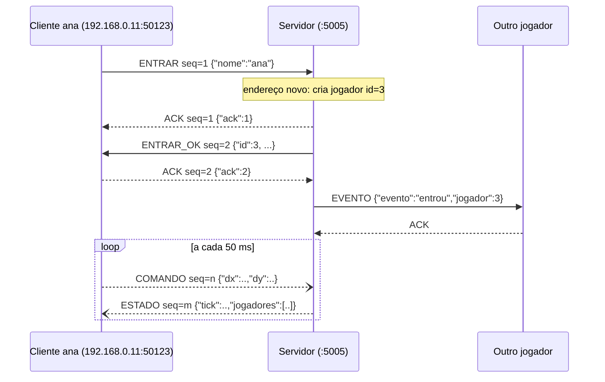
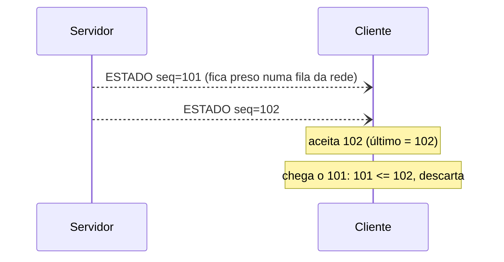

# Protocolo do Arena em Rede (versão 1)

> **Contrato da equipe.** O cliente (Integrante 2) e os experimentos (Integrante 3)
> dependem deste documento. Qualquer mudança aqui precisa ser combinada antes.
> Cada bloco `json` deste arquivo é um exemplo de mensagem válida e é conferido
> automaticamente por `testes/test_protocolo_doc.py`: se o código e o documento
> divergirem, o teste quebra.

Implementação: `protocolo/mensagens.py` (formato e validação) e
`protocolo/sequencia.py` (números de sequência). Valores citados como
`config.X` estão em `config.py`.

---

## 1. Visão geral

- **Arquitetura cliente-servidor com servidor autoritativo.** O cliente só envia
  intenções (teclas); posições, colisões e placar são calculados no servidor. O
  cliente nunca diz "estou em (x, y)", então não tem como trapacear mudando a
  própria posição.
- **Transporte: UDP**, porta `config.PORTA_PADRAO` (5005). O servidor usa **um
  único socket** para todos os clientes e os distingue pelo endereço de origem
  (IP, porta) de cada datagrama.
- **Uma mensagem por datagrama**, codificada como um objeto **JSON em UTF-8**,
  compacto (sem espaços).
- **Confiabilidade seletiva.** Só os tipos que não podem se perder (entrada,
  saída, eventos) usam ACK e retransmissão. Comandos e estados são enviados 20
  vezes por segundo e um perdido é logo substituído pelo próximo.

## 2. Limite de tamanho: 1200 bytes por datagrama

Toda mensagem codificada tem **no máximo 1200 bytes** (`config.TAMANHO_MAXIMO_DATAGRAMA`).
`codificar()` recusa mensagens maiores (`MensagemGrandeDemais`) e `decodificar()`
descarta datagramas maiores.

**Por quê:** se o datagrama IP passar do MTU (o maior quadro que o enlace carrega),
ele é **fragmentado**. Os fragmentos viajam separados e o destino só entrega o
datagrama se todos chegarem: perder **um** fragmento perde a mensagem inteira. Com
perda independente `p` por pacote, uma mensagem em `k` fragmentos se perde com
probabilidade `1 − (1 − p)^k` (com `p` = 5%, 2 fragmentos já dão 9,75%). Além disso,
no IPv6 os roteadores não fragmentam: o pacote grande demais é descartado.

Orçamento de bytes (cabeçalhos sem opções):

| Caminho | MTU | − IP | − UDP | Carga útil máxima sem fragmentar |
|---|---|---|---|---|
| Ethernet, IPv4 | 1500 | 20 | 8 | 1472 |
| PPPoE (internet doméstica), IPv4 | 1492 | 20 | 8 | 1464 |
| Ethernet, IPv6 | 1500 | 40 | 8 | 1452 |
| MTU mínimo garantido do IPv6 | 1280 | 40 | 8 | 1232 |

1200 bytes cabem em todos esses casos e ainda sobra margem para túneis e VPNs, que
reduzem o MTU efetivo. O QUIC (RFC 9000) usa o mesmo valor como tamanho mínimo de
datagrama pelo mesmo motivo.

O limite é em **bytes**, não em caracteres: em UTF-8, "a" ocupa 1 byte, "ç" ocupa 2
e um emoji ocupa 4.

Tamanhos reais (medidos com `codificar`): COMANDO, 76 B; ESTADO com 2 jogadores e
5 moedas, 294 B; ESTADO com 8 jogadores, 713 B. **Pior caso:** 8 jogadores com nomes
de 12 emojis (48 bytes cada) e todos os inteiros com 10 dígitos, 1138 B. É por isso
que existem `config.MAX_JOGADORES` = 8 e o limite de 12 caracteres no nome. Um teste
(`test_estado_no_pior_caso_cabe_em_um_datagrama`) garante que esse pior caso continua
cabendo, mesmo que alguém mude o `config.py`. Com nomes de 16 emojis, o pior caso
passaria do limite (1234 B).

## 3. Cabeçalho comum

Toda mensagem tem os mesmos cinco campos no nível de cima:

```json
{"v":1,"tipo":"COMANDO","seq":42,"ts":1795564800123,"dados":{"dx":1,"dy":0}}
```

| Campo | Tipo JSON | Significado |
|---|---|---|
| `v` | inteiro | Versão do protocolo. Hoje, `1`. |
| `tipo` | texto | Um dos tipos da seção 6. |
| `seq` | inteiro ≥ 0 | Número de sequência do remetente para este destinatário (seção 4). |
| `ts` | inteiro ≥ 0 | Instante de envio, em ms desde a época Unix, no relógio do remetente (seção 5). |
| `dados` | objeto | Conteúdo específico do tipo (seção 7). |

### Mensagens inválidas

O destinatário **descarta** a mensagem, **registra no log** (endereço, motivo,
tamanho) e **não responde nada** se acontecer qualquer uma destas situações:

- os bytes não são UTF-8 válido, ou não são JSON, ou o JSON não é um objeto;
- falta algum campo do cabeçalho;
- `v` não é `1` (versão desconhecida);
- `tipo` é desconhecido;
- `seq` ou `ts` não é inteiro ≥ 0. `true`/`false` não contam como número;
- `dados` não é objeto, ou não tem os campos exigidos pelo tipo, com o tipo certo;
- aparecem `NaN`, `Infinity` ou números que estouram para infinito (`1e999`);
- o datagrama tem mais de 1200 bytes.

Não responder a lixo evita dois problemas: um laço de mensagens de erro entre dois
programas defeituosos, e o uso do servidor para refletir tráfego contra um endereço
de origem forjado. Mensagens inválidas **nunca derrubam** servidor nem cliente.

Campos **extras** (no cabeçalho ou em `dados`) são ignorados. Assim uma versão
futura pode acrescentar campos sem quebrar quem só entende a versão 1.

## 4. Números de sequência (`seq`)

- **Um espaço de sequência por par remetente → destinatário.** O cliente tem um
  contador para as mensagens que envia ao servidor. O servidor tem **um contador
  por cliente**, guardado na tabela de clientes. É como no TCP, em que cada sentido
  de cada conexão tem seu próprio número de sequência.
- O contador **começa em 1** e soma 1 a **cada mensagem nova enviada**, de qualquer
  tipo (inclusive ACK e PING). Com isso, `0` fica livre para significar "nada ainda".
- **Uma retransmissão reenvia a mesma mensagem, com o mesmo `seq` e o mesmo `ts`.**
  É assim que o destinatário reconhece uma duplicata.
- **O `seq` não dá a volta**: inteiros JSON não têm limite (no TCP ele tem 32 bits).

Para que serve:

1. **Descartar dados velhos que chegaram fora de ordem.** Em COMANDO (no servidor)
   e ESTADO (no cliente), uma mensagem com `seq <= último seq aceito daquele tipo`
   é descartada (`FiltroMaisRecente`).
2. **Detectar duplicatas** de mensagens confiáveis (seção 8).
3. **Medir perda.** Como todo datagrama do servidor para um cliente consome um
   `seq` daquele cliente, as lacunas na sequência recebida são datagramas perdidos.
   Um `seq` que chega depois de um maior é reordenação, não perda.

**Limitação conhecida:** se um cliente reiniciar e reaproveitar a mesma porta de
origem antes de o servidor removê-lo por inatividade, o servidor ainda o verá como
o cliente antigo. O TCP evita isso sorteando o número de sequência inicial; aqui não
foi necessário, porque o sistema operacional normalmente dá outra porta efêmera.

## 5. Carimbo de tempo (`ts`)

- Milissegundos desde a época Unix, lidos do relógio de parede do remetente
  (`agora_ms()`).
- **Relógios de máquinas diferentes não são sincronizados.** Por isso o `ts` alheio
  só pode ser usado de dois jeitos:
  - **RTT:** o servidor devolve no PONG o `ts` do PING (`ts_eco`), e o cliente calcula
    `agora_ms() − ts_eco` com o **próprio** relógio;
  - **jitter:** comparando *diferenças*. Para dois ESTADOs `i` e `j`,
    `D = (chegada_j − chegada_i) − (ts_j − ts_i)`; a defasagem entre os relógios se
    cancela (é a fórmula do jitter do RTP, RFC 3550).
- Atraso de ida (chegada − `ts`) só faz sentido com cliente e servidor na mesma
  máquina.
- Os temporizadores internos (retransmissão, inatividade) usam `time.monotonic()`,
  que não sofre ajustes de relógio.

## 6. Resumo dos tipos

| Tipo | Quem envia | Confiável? | Quando |
|---|---|---|---|
| `ENTRAR` | cliente | sim | Para pedir para entrar na partida. |
| `ENTRAR_OK` | servidor | sim | Para aceitar a entrada; informa o id e os parâmetros da arena. |
| `ENTRAR_NEGADO` | servidor | sim | Para recusar a entrada (partida cheia). |
| `SAIR` | cliente | sim | Para sair da partida. |
| `COMANDO` | cliente | não | Teclas atuais, `config.TAXA_COMANDOS` (20) vezes por segundo. |
| `ESTADO` | servidor | não | Snapshot da partida, a cada tick (20 por segundo), para cada cliente. |
| `EVENTO` | servidor | sim | Acontecimentos que não podem se perder: ponto, entrada, saída. |
| `ACK` | ambos | não | Confirma uma mensagem confiável. |
| `PING` | cliente | não | Para medir o RTT. |
| `PONG` | servidor | não | Resposta imediata ao PING. |

"Confiável" é uma propriedade **do tipo** (`TIPOS_CONFIAVEIS`): o destinatário sabe
pelo `tipo` se precisa mandar ACK; não existe uma flag no datagrama.

## 7. Mensagens

### ENTRAR (cliente → servidor, confiável)

```json
{"v":1,"tipo":"ENTRAR","seq":1,"ts":1795564800123,"dados":{"nome":"ana"}}
```

- `nome`: texto imprimível (sem quebras de linha), de 1 a 12 caracteres
  (`config.TAMANHO_MAXIMO_NOME`).
- Se o endereço já é de um jogador, o servidor **não cria outro jogador**: responde
  de novo com ENTRAR_OK e o mesmo `id`.

### ENTRAR_OK (servidor → cliente, confiável)

```json
{"v":1,"tipo":"ENTRAR_OK","seq":2,"ts":1795564800125,"dados":{"id":3,"largura":800,"altura":600,"raio_jogador":15,"raio_moeda":8,"velocidade":200,"taxa":20}}
```

- `id`: identificador do jogador nesta partida.
- `largura`, `altura`: tamanho da arena em pixels. `raio_jogador`, `raio_moeda`: em
  pixels. `velocidade`: em pixels por segundo. `taxa`: ESTADOs por segundo.
- São todos inteiros ≥ 0. O cliente deve usar estes valores, não os do seu
  `config.py`: quem manda é o servidor.

### ENTRAR_NEGADO (servidor → cliente, confiável)

```json
{"v":1,"tipo":"ENTRAR_NEGADO","seq":2,"ts":1795564800125,"dados":{"motivo":"partida cheia"}}
```

- Enviado quando já há `config.MAX_JOGADORES` jogadores.
- O servidor guarda o endereço recusado (sem jogador) até o timeout de inatividade.
  Isso permite retransmitir o ENTRAR_NEGADO e reconhecer um ENTRAR duplicado. Se abrir
  uma vaga, um ENTRAR novo desse endereço é aceito.

### SAIR (cliente → servidor, confiável)

```json
{"v":1,"tipo":"SAIR","seq":950,"ts":1795564847000,"dados":{}}
```

- O servidor confirma com ACK, remove o jogador e avisa os outros com EVENTO `saiu`.
- Se o SAIR vier de um endereço que não está na partida (por exemplo, a
  retransmissão de um SAIR já processado), o servidor só responde o ACK, para que o
  cliente pare de retransmitir.

### COMANDO (cliente → servidor, não confiável)

```json
{"v":1,"tipo":"COMANDO","seq":43,"ts":1795564800173,"dados":{"dx":-1,"dy":1}}
```

- `dx`, `dy`: `-1`, `0` ou `1`. É a direção que as teclas indicam *agora*
  (`dx = -1` é esquerda, `dy = -1` é cima, porque o eixo y cresce para baixo, como
  na tela).
- O COMANDO carrega o **estado** das teclas, não eventos como "apertou" ou "soltou".
  O cliente envia um COMANDO **20 vezes por segundo, mesmo que nada tenha mudado**.
  Se um se perder, o próximo corrige 50 ms depois. Se o cliente só mandasse quando
  a tecla muda e esse único datagrama se perdesse, o jogador ficaria andando
  sozinho.
- O envio contínuo também mantém o cliente "vivo" para o timeout de inatividade.
- O servidor descarta um COMANDO com `seq <=` o do último COMANDO aceito daquele
  cliente: ele chegou fora de ordem e já foi superado.
- O servidor guarda só o COMANDO mais recente e o aplica no próximo tick.

### ESTADO (servidor → cliente, não confiável)

```json
{"v":1,"tipo":"ESTADO","seq":120,"ts":1795564800400,"dados":{"tick":3051,"ultimo_comando":87,"jogadores":[{"id":3,"nome":"ana","x":412.5,"y":233.0,"pontos":4},{"id":4,"nome":"robo-1","x":98.0,"y":501.5,"pontos":2}],"moedas":[[120.0,80.5],[640.0,410.0],[333.5,512.0],[705.0,95.5],[50.5,300.0]]}}
```

- `tick`: número do passo de simulação, que avança 1 por tick. É igual para todos os
  clientes.
- `ultimo_comando`: `seq` do último COMANDO **deste** cliente aplicado pelo servidor
  até este tick, ou `0` se nenhum. Serve para a previsão local com reconciliação: o
  cliente descarta as previsões até esse `seq` e reaplica as posteriores sobre a
  posição oficial.
- `jogadores`: todos os jogadores da partida, com `id`, `nome`, posição do centro
  `x`, `y` (no máximo 1 casa decimal) e `pontos`. O placar sai daqui.
- `moedas`: lista de `[x, y]` com o centro de cada moeda.
- Como `seq` e `ultimo_comando` são de cada cliente, o servidor monta **um ESTADO
  por cliente** a cada tick. O resto do conteúdo é igual para todos.
- O cliente descarta um ESTADO com `seq <=` o do último ESTADO aceito: é velho e
  chegou fora de ordem.
- O ESTADO é a **verdade** sobre quem está na partida e onde. O EVENTO serve para
  avisar e animar.

### EVENTO (servidor → cliente, confiável)

```json
{"v":1,"tipo":"EVENTO","seq":40,"ts":1795564801000,"dados":{"evento":"ponto","jogador":3,"pontos":5}}
```

```json
{"v":1,"tipo":"EVENTO","seq":41,"ts":1795564802000,"dados":{"evento":"entrou","jogador":4,"nome":"robo-1"}}
```

```json
{"v":1,"tipo":"EVENTO","seq":42,"ts":1795564803000,"dados":{"evento":"saiu","jogador":4,"motivo":"inatividade"}}
```

| `evento` | Campos extras | Destinatários |
|---|---|---|
| `ponto` | `pontos`: total do jogador após o ponto | todos |
| `entrou` | `nome` | todos menos quem entrou (ele já sabe pelo ENTRAR_OK) |
| `saiu` | `motivo`: `"pediu"` ou `"inatividade"` | todos os que ficaram |

- `jogador`: id do jogador envolvido.
- Os eventos são entregues na ordem em que chegam, sem reordenação. Isso basta
  porque o ESTADO seguinte mostra o resultado final de qualquer forma.

### ACK (cliente ↔ servidor, não confiável)

```json
{"v":1,"tipo":"ACK","seq":43,"ts":1795564801012,"dados":{"ack":40}}
```

- `ack`: o `seq` da mensagem confiável confirmada. **Cada ACK confirma uma única
  mensagem**: não é cumulativo como o do TCP.
- O ACK tem seu próprio `seq` no cabeçalho, como qualquer mensagem.
- **Um ACK nunca é confirmado.** Se fosse, o ACK do ACK também precisaria de ACK, e
  assim por diante, sem fim.

### PING (cliente → servidor) e PONG (servidor → cliente), não confiáveis

```json
{"v":1,"tipo":"PING","seq":77,"ts":1795564805000,"dados":{}}
```

```json
{"v":1,"tipo":"PONG","seq":130,"ts":1795564805021,"dados":{"ts_eco":1795564805000}}
```

- O servidor responde o PING **imediatamente**, assim que o lê do socket, sem esperar
  o próximo tick. Se esperasse, o RTT medido incluiria até 50 ms de espera que não
  são da rede.
- `ts_eco` é o `ts` do PING. O cliente calcula `RTT = agora_ms() − ts_eco`.
- O servidor responde PING mesmo de quem ainda não entrou na partida. O PONG tem o
  mesmo tamanho do PING, então isso não amplifica tráfego.
- Um PING perdido é só uma amostra a menos (e conta como perda). Ele não é
  retransmitido.

## 8. Confiabilidade (tipos confiáveis)

Implementada em `protocolo/confiavel.py` (etapa d), sem dependência de socket. Há
uma instância por par: o cliente tem uma para o servidor, e o servidor tem uma por
cliente, cada uma com sua própria estimativa de RTT.

### Remetente

1. Envia a mensagem e a guarda como **pendente**, com o instante do envio e o número
   de tentativas.
2. Quando chega o `ACK` com `ack = seq`, remove a mensagem das pendentes. Se ela foi
   transmitida **uma única vez**, o tempo até o ACK vira uma amostra de RTT.
3. Se o **timeout** estoura antes do ACK, **retransmite** a mesma mensagem e **dobra
   o timeout** dela (backoff exponencial, até `config.TIMEOUT_MAXIMO`).
4. Depois de `config.MAX_TENTATIVAS` (5) transmissões sem ACK, **desiste** e avisa a
   aplicação. Desistir não prova que a mensagem não chegou: podem ter sido só os ACKs
   que se perderam.
5. Um ACK de um `seq` que não está pendente (já confirmado ou abandonado) é ignorado.

O temporizador é **por mensagem**: cada mensagem nova começa com o `TimeoutInterval`
atual, e o backoff só afeta a própria mensagem. Sem nenhuma amostra de RTT, as
transmissões saem em 0, 1, 3, 6 e 9 s, e a desistência vem em 12 s.

### Destinatário

1. Ao receber uma mensagem confiável, **sempre** responde com `ACK`, mesmo que seja
   duplicata. Se o ACK anterior se perdeu, o remetente só para de retransmitir
   quando receber um novo.
2. Se o `seq` já foi visto, é uma **duplicata**: confirma de novo, mas **não entrega**
   à aplicação. Um ponto não pode ser contado duas vezes.
3. O destinatário lembra os últimos `config.JANELA_DUPLICATAS` (1024) `seq`. Um `seq`
   mais antigo que essa janela é tratado como duplicata.

### Timeout adaptativo

Inspirado no TCP (Kurose, Cap. 3, estimativa do RTT e timeout do TCP), com
α = 0,125 e β = 0,25:

```text
EstimatedRTT    = (1 − α) · EstimatedRTT + α · SampleRTT
DevRTT          = (1 − β) · DevRTT       + β · |SampleRTT − EstimatedRTT|
TimeoutInterval = EstimatedRTT + 4 · DevRTT     (limitado a [TIMEOUT_MINIMO, TIMEOUT_MAXIMO])
```

- Antes da primeira amostra, `TimeoutInterval = config.TIMEOUT_INICIAL` (1 s, o
  valor inicial que o livro cita). Na primeira amostra, `EstimatedRTT = SampleRTT` e
  `DevRTT = SampleRTT / 2`. A ordem de atualização segue a RFC 6298: o `DevRTT` é
  calculado com o `EstimatedRTT` *anterior*.
- **Mensagens retransmitidas não geram amostra** (algoritmo de Karn). Quando chega o
  ACK de uma mensagem enviada duas vezes, não há como saber se ele confirma a
  primeira ou a segunda transmissão. Medir a partir da primeira infla o RTT; medir a
  partir da segunda pode subestimá-lo. Como as duas opções contaminam a estimativa,
  a amostra é descartada.
- O `TIMEOUT_MINIMO` (100 ms) existe porque, em localhost, o RTT é de décimos de
  milissegundo e o timeout calculado ficaria tão curto que qualquer atraso de
  escalonamento do sistema operacional causaria retransmissão desnecessária.

## 9. Regras do servidor

- **Laço com taxa fixa** (`config.TAXA_ATUALIZACAO`, 20 ticks/s). A cada tick: aplica
  o último COMANDO de cada jogador, avança a simulação, detecta colisões com moedas,
  envia um ESTADO a cada cliente e confere timeouts.
- **Tabela de clientes indexada por (IP, porta) de origem**, com id do jogador,
  contador de `seq` de envio, último `seq` de COMANDO aceito e instante da última
  mensagem recebida.
- Qualquer mensagem válida recebida atualiza o "visto por último". Um cliente que
  fica `config.TIMEOUT_INATIVIDADE` (5 s) em silêncio é removido, e os outros recebem
  EVENTO `saiu` com motivo `"inatividade"`.
- Mensagens de um endereço desconhecido:
  - ENTRAR é processado;
  - PING é respondido;
  - SAIR recebe só o ACK;
  - todo o resto é descartado e registrado no log.

## 10. Regras do cliente

- Enviar ENTRAR e só considerar ESTADOs depois do ENTRAR_OK, porque é ele que traz o
  próprio `id`.
- Enviar COMANDO a 20/s durante toda a partida, mesmo parado (`dx = dy = 0`).
- Descartar ESTADO com `seq <=` o último aceito.
- Confirmar com ACK toda mensagem confiável recebida e processar cada EVENTO uma
  única vez.
- Enviar PING periodicamente (sugestão: 1 por segundo) para medir o RTT.
- Enviar SAIR ao fechar. A `SessaoCliente.sair()` espera até 1 s pelo ACK.
- Considerar o servidor fora do ar se ficar `config.TIMEOUT_INATIVIDADE` sem receber
  ESTADO.
- A classe `SessaoCliente` (`protocolo/sessao.py`, etapa c) implementa tudo isso; o
  cliente pygame e o robô a usam.

### Regras da simulação (para a previsão local do cliente)

- A cada tick (`dt = 1/taxa` s), o centro do jogador anda `velocidade · dt` pixels na
  direção `(dx, dy)`. Na diagonal o vetor é normalizado (dividido por √2), para que
  andar na diagonal não seja mais rápido.
- O centro fica sempre dentro de `[raio_jogador, largura − raio_jogador]` ×
  `[raio_jogador, altura − raio_jogador]`.
- Um jogador pega uma moeda quando a distância entre os centros é
  `<= raio_jogador + raio_moeda`. Ganha 1 ponto, e a moeda reaparece numa posição
  aleatória.

## 11. Diagramas de sequência

### Entrada de um jogador

Os `seq` são independentes nos dois sentidos: o cliente numera as mensagens dele e
o servidor numera as que manda para este cliente.



### Evento retransmitido: perda do dado e perda do ACK

```mermaid
sequenceDiagram
    participant S as Servidor
    participant C as Cliente
    S-xC: EVENTO seq=40 {"evento":"ponto"} (perdido na rede)
    Note over S: TimeoutInterval estoura sem ACK
    S->>C: EVENTO seq=40 (retransmissão 1, mesmo seq)
    Note over C: seq=40 é novo: processa o ponto
    C-xS: ACK {"ack":40} (perdido na rede)
    Note over S: timeout (agora dobrado) estoura de novo
    S->>C: EVENTO seq=40 (retransmissão 2)
    Note over C: seq=40 já visto: duplicata, NÃO processa de novo
    C-->>S: ACK {"ack":40}
    Note over S: confirmado; sem amostra de RTT (houve retransmissão)
```

### ESTADO fora de ordem



## 12. Transporte TCP (comparação, etapa f)

As mesmas mensagens podem trafegar sobre TCP, para o Integrante 3 comparar os dois.
Como o TCP entrega um **fluxo de bytes** sem fronteiras de mensagem (um `recv` pode
trazer meia mensagem, ou duas grudadas), cada mensagem é precedida pelo seu
tamanho:

```text
+----------------------+------------------------------+
| tamanho (2 bytes)    | mensagem JSON (tamanho bytes)|
| inteiro sem sinal,   |                              |
| big-endian ("!H")    |                              |
+----------------------+------------------------------+
```

Dois bytes comportam até 65535, bem acima do limite de 1200. "Big-endian" é a ordem
de bytes da rede, a mesma dos cabeçalhos IP, UDP e TCP. Os detalhes (como ligar e
desligar o ACK da aplicação sobre TCP, `TCP_NODELAY`) serão combinados com o
Integrante 3 na etapa f.

## 13. Situação da implementação

| Parte | Etapa | Situação |
|---|---|---|
| Formato, validação, limite de 1200 B (`mensagens.py`) | a | pronto |
| Números de sequência e descarte de velhos (`sequencia.py`) | a | pronto |
| Servidor UDP mínimo: ENTRAR, ENTRAR_NEGADO, SAIR, ESTADO, COMANDO, inatividade | b | pronto |
| Lógica do jogo, EVENTO, robô, `SessaoCliente` | c | pronto |
| ACK, timeout, retransmissão e duplicatas (`confiavel.py`) | d | pronto |
| Simulador de perda e atraso (`ferramentas/perda.py`) | d | pronto |
| PING/PONG, contadores, log estruturado | e | planejado |
| Transporte TCP com enquadramento | f | planejado |

Desde a etapa d, ENTRAR, ENTRAR_OK, ENTRAR_NEGADO, SAIR e EVENTO usam ACK e
retransmissão, exatamente como na seção 8. (Nas etapas b e c havia um mecanismo
provisório, em que o cliente reenviava ENTRAR a cada 0,5 s; ele foi removido.)

## 14. Mudanças em relação à proposta inicial

| Mudança | Motivo |
|---|---|
| `seq` por par remetente → destinatário (o servidor tem um contador por cliente) | Espelha o TCP (um espaço de sequência por conexão) e permite medir perda pelas lacunas de `seq`. Com um contador global, as lacunas incluiriam mensagens enviadas a outros jogadores. |
| Retransmissão com o mesmo `seq` e o mesmo `ts` | Sem isso não há como reconhecer duplicatas. |
| ACK individual: `{"ack": seq}` | Cada mensagem confiável tem seu próprio temporizador e seu próprio ACK, como na repetição seletiva do livro. |
| `tick` e `ultimo_comando` no ESTADO | `tick` numera a simulação; `ultimo_comando` permite a previsão local com reconciliação no cliente. |
| COMANDO com o estado das teclas (`dx`, `dy`), enviado a 20/s | É tolerante a perda (o próximo corrige) e serve de sinal de vida para o timeout de inatividade. |
| Parâmetros da arena no ENTRAR_OK | O servidor é a autoridade: o cliente não depende de ter o mesmo `config.py`. |
| Novo tipo ENTRAR_NEGADO | Limitar os jogadores é o que garante que o ESTADO caiba em 1200 B; o cliente precisa saber por que não entrou. |
| `ts_eco` no PONG | Formaliza o "eco do ts" para o cálculo do RTT. |
| `ts` em ms de relógio de parede | É legível e permite correlacionar com o horário do Wireshark; o uso correto está na seção 5. |
| Descarte com `seq <=` (não só `<`) | Também descarta cópias duplicadas de mensagens não confiáveis. |

## 15. Histórico do documento

| Data | Mudança |
|---|---|
| 15/11/2026 | Versão 1 do contrato (etapa a), com os refinamentos aprovados pela equipe. |
| 15/11/2026 | Etapas b e c implementadas. Nenhuma mudança de formato. Situação atualizada na seção 13. |
| 15/11/2026 | Etapa d implementada. Nenhuma mudança de formato. Detalhes da seção 8 (temporizador por mensagem, ACK desconhecido, desistência) e do ENTRAR_NEGADO explicitados. |
